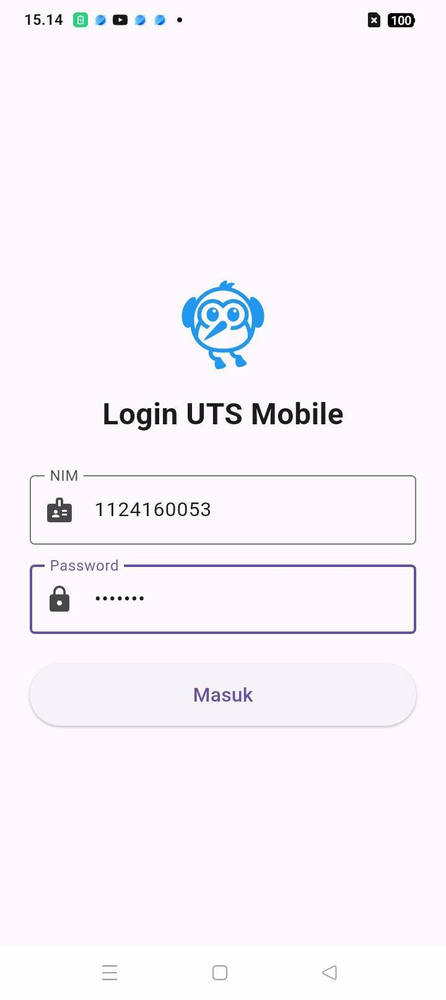
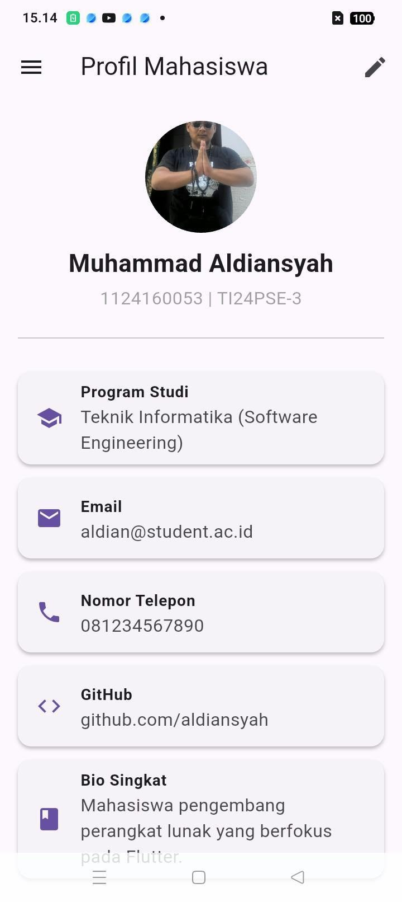
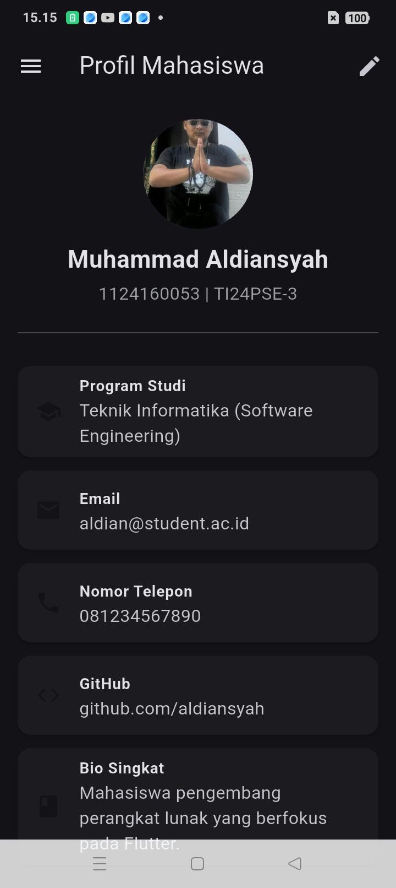

# 📱 Aplikasi Profil Mahasiswa - UTS Mobile

Aplikasi mobile berbasis **Flutter** yang dikembangkan secara khusus untuk memenuhi Ujian Tengah Semester (UTS) mata kuliah **Pemrograman Mobile**.

---

## 👨‍💻 Identitas Mahasiswa
* **Nama Lengkap:** Muhammad Aldiansyah
* **NIM:** 1124160053
* **Kelas:** TI24PSE-3
* **Program Studi:** Teknik Informatika (Software Engineering)
* **Perguruan Tinggi:** Institut Teknologi dan Bisnis Bina Sarana Global

---

## 🚀 Fitur Utama Aplikasi
1. **Autentikasi Login Berbasis NIM:** Validasi masuk aplikasi menggunakan NIM mahasiswa (`1124160053`) dan password khusus (`aldi123`).
2. **Halaman Profil Utama:** Menampilkan informasi biodata lengkap mahasiswa beserta aset foto profil lokal.
3. **Dukungan Tema Dinamis (*Dark/Light Mode*):** Mengikuti pengaturan sistem perangkat secara otomatis (`ThemeMode.system`).
4. **Dialog Konfirmasi Logout:** Fitur pop-up keamanan saat pengguna ingin keluar dari sesi aplikasi.

---


## 📂 Struktur Direktori Proyek

```text
soal2_profil_app/
│
├── android/               # Konfigurasi spesifik platform Android
├── assets/                # Aset gambar dan media (fotoku.jpg)
├── lib/                   # Kode sumber utama Flutter (Dart)
│   ├── screens/           # Halaman Login, Profil, dll
│   └── main.dart          # Titik masuk utama aplikasi & konfigurasi tema
├── pubspec.yaml           # Konfigurasi dependensi dan aset
└── README.md              # Dokumentasi proyek
```

---


## 📸 Dokumentasi Tampilan Aplikasi (Screenshot)

**1. Halaman Login**



**2. Halaman Profil (Light Mode)**



**3. Halaman Profil (Dark Mode)**


